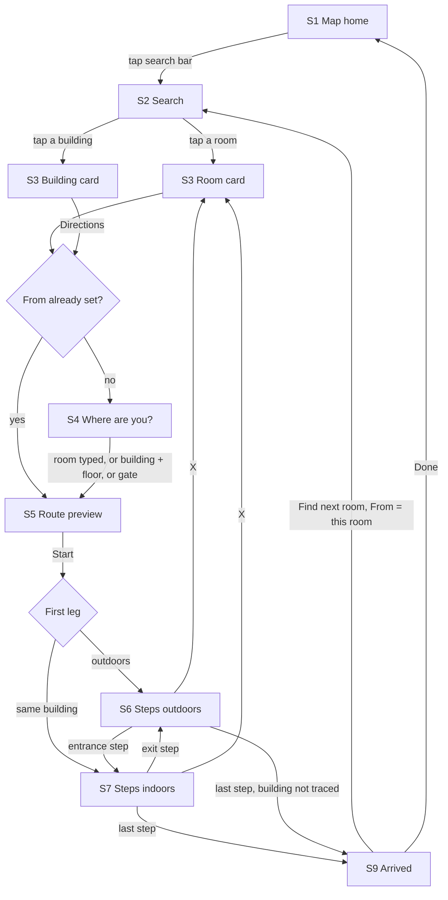
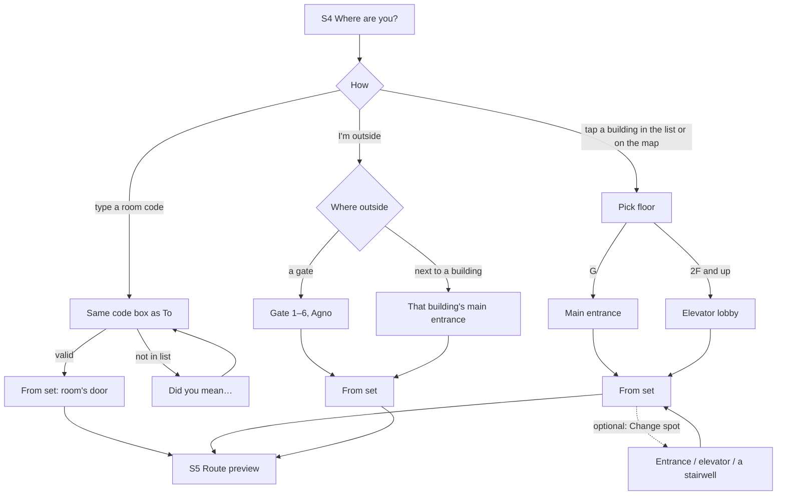
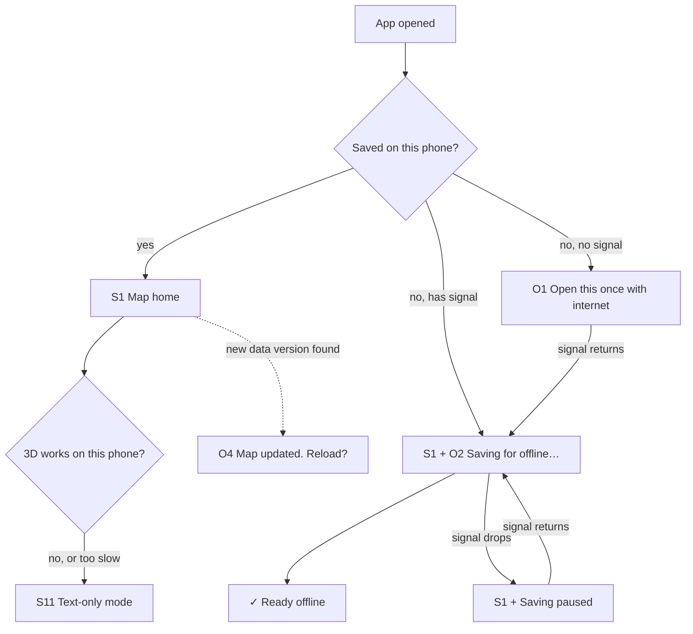

# DLSU 3D Campus Navigator: User Flows

> **Status:** draft for review, written 2026-10-19 from `docs/PRD.md`, `docs/ARCHITECTURE.md`, `docs/PLAN.md` §6 and
> a Q&A with the owner. Every screen, every way between them, and every empty, loading and error state. Where this
> file and `PLAN.md` §6 differ, this file wins. New decisions from the Q&A are D23 and D24 (proposed).

## 1. Ground rules for every flow

- **Navigation:** one screen. The 3D map fills it, the search bar sits on top, and a bottom sheet (peek / half /
  full) holds everything else. **No tab bar, no hamburger menu, no page changes.** Back on Android and the browser
  closes the top sheet first, then steps back through the flow.
- **No sign-in anywhere.** There are no accounts (D11), so no screen is gated and there is no login path to secure.
- **From is never stored.** It lives in memory and is gone when the app closes. Recents hold destinations only.
- **Nothing runs on a silent guess.** The route preview (S5) shows `From → To` before Start, every time.
- **One obvious action per screen.** It is named in each screen's row in §2.

## 2. Screen inventory (11 screens, 6 system states, 1 dev-only page)

| # | Screen | Where | The one primary action |
|---|---|---|---|
| S1 | **Map home** | Map + search bar + sheet at peek | Tap the search bar |
| S2 | **Search (To)** | Full-screen list over the map | Tap a result |
| S3 | **Room card** | Sheet: "ST311 · Surface Physics Lab · STRC 3F", building highlighted | (Opens S4 at once if From is empty) |
| S4 | **Where are you?** | Sheet at half, room card line still visible above it | Type your room, or pick a building |
| S5 | **Route preview** | Sheet: `From → To`, time, distance, route on map | **Start** |
| S6 | **Steps, outdoors** | Step card + campus camera | **Next** |
| S7 | **Steps, indoors** | Step card + building cutaway + floor rail | **Next** |
| S8 | **All steps** | Full list of steps with floor and turn icons | Tap a step to jump to it |
| S9 | **Arrived** | Sheet: "✓ You're at ST311" | **Find next room** |
| S10 | **ⓘ sheet** | Offline status, Report a problem, About and credits, version | (Info only) Report a problem |
| S11 | **Text-only mode** | The whole app without 3D: S2, S4 and S8 as lists | Same as the screen it replaces |

| # | System state | Shows as |
|---|---|---|
| O1 | First open with no signal | Full screen: "Open this once with internet to save the map". Only when the app opened with no signal and nothing downloaded. No button; it reloads by itself when signal returns |
| O2 | Saving for offline | Thin line under the search bar: "Saving for offline…", then "✓ Ready offline" for 3 s. The percentage ("…40%") waits for 10a. If it can't finish, the line stays: "Saving paused…" (signal dropped after opening; retried when it returns), "Not saved for offline…" (failed with signal), "This browser can't save the map…" (private modes) |
| O3 | Offline copy lost (iPhone cleared storage) | ⓘ shows "Not saved offline. Open with internet to save again" |
| O4 | Map update ready | Toast: "Map updated. Reload?" Never shown mid-route |
| O5 | Interior not traced yet (beta) | Route ends at the entrance; S9 says "ST311 is on 3F · indoor map coming" |
| O6 | Unverified entrance, stair or elevator | The step text ends with "(approximate)" |

| # | Dev-only | Where |
|---|---|---|
| P1 | **Floor preview** | Only in `npm run dev`, never in the shipped app. Pick building + floor; see walls, labels, doors, stairs, elevator and a test route |

Always visible on the map: the search bar, a small **ⓘ** and a **Beta** tag beside it (D19), and the
"© OpenStreetMap" credit in a corner.

## 3. The freshman between classes (primary user)

### 3.1 Main flow



**Step count, honestly:**

- **First trip of the day:** type `ST311` → tap the result → type `AG1104` in Where are you (or tap Andrew → 11F) →
  Start. That's 3–4 actions before walking.
- **Every trip after that:** tap Find next room → type the code → tap the result → Start. From is already set.
- **Just need the building and floor:** type `ST311` → tap the result. The answer is on screen at step 2. That is
  the 10-second target (PRD §5).

### 3.2 S1 Map home: first open and every open after

- **First ever open:** campus in 3D, search bar ("Where to?"), sheet at peek with one line: **"Type a room, like
  ST311"**. No intro cards. The keyboard does not open by itself, so the map stays visible.
- **Returning:** the sheet shows **Recent**: the last 5 rooms searched, saved on this phone only. Tapping one goes
  straight to S3.
- **Loading:** the search bar works before the 3D scene finishes. `rooms.json` loads first. If the student types
  before it's ready, S2 shows "Loading rooms…" and fills in when ready.
- **O2** runs at the same time. The app is usable at once and never makes a student wait for the full download.

### 3.3 S2 Search (To)

| Typed | List shows |
|---|---|
| Nothing yet | Recent (or the hint, if there are none) |
| `ST311`, `st 311`, `C311`, `C-311` | **ST311 · Surface Physics Lab · STRC 3F** at the top |
| `Andrew` or `AG` | **Andrew Hall** (building) |
| `ST350` (not in the list) | "ST350 isn't in our list." + **Did you mean** ST305, ST310… |
| `X305` (unknown prefix) | "No building uses X." + building names with their prefixes |
| `VH501`, `J-201` (as printed on a sign, D25) | **Did you mean VL501 · Velasco** (one tap accepts it) |
| `305` (no prefix, as St. Miguel's signs print it) | Rooms numbered 305 in each building |
| `ST404/406` | **ST404** (read as the first number, D18) |
| `ST31`, `c40` (still typing, D38) | The rooms that start with it, 8 at most. Rejected only when none do |
| `AG1104` (building with no room list yet, D38) | "Br. Andrew Gonzalez Hall's rooms aren't in the app yet." + the building |
| `velsaco` (one typo, D38) | **Did you mean** Velasco |
| `Henry Sy` (block tier, D20) | "Henry Sy Sr. Hall isn't in search yet." |
| `Biology` (room names aren't searched in v1) | "Nothing matches "Biology". Search by room code, like ST311, or a building." |

- `C311` is shown and stored as `ST311` (canonical form, ARCHITECTURE §3.3), with "also written C311" under it.
- There is no Search button. Results update as you type, and tapping one is the main action. The keyboard's **Go**
  opens a result only when the text is exactly one room or building; otherwise it hides the keyboard (D38).
- **Recent** holds the last 5 destinations tapped, rooms and buildings (D38).
- **Until 3d:** tapping a room shows a plain card (code, name, "STRC · 3F") and highlights its building.
- **Building as destination:** the route ends at that building's main entrance. S9 says "You're at Andrew Hall".

### 3.4 S3 Room card

- At the top of the sheet: code, room name, then building and floor ("STRC · 3rd floor (3F)"), and "Also written
  C311" when it was typed that way. The building glows on the map, and its floor is a green band around the
  building's side with a floor chip ("3F"); the camera turns to a heading that sees the band (3d).
- **Share** (Should, PRD §8), an icon button beside Close: shares a link with **only the destination**,
  `…/?to=ST311`. From is never put in a link. With no share sheet it copies the link and says "Link copied" (D40).
- If From is empty, S4 opens **right away** under the card (D23). A student who only needed the floor just closes
  it. The room line stays visible above the picker, so nothing has to be remembered.

### 3.5 S4 Where are you?



- **Order on screen:** code box at the top ("I'm in room…"). Below it, the 10 buildings as a list, each with its
  name and prefix ("Andrew Hall · AG"). The last item is "I'm outside". Tapping a building on the 3D map does the same
  as tapping it in the list.
- **Floors** are listed with each building's own labels (`G`, `2F`, …). This depends on ARCHITECTURE §9 open
  item 1.
- **Spot is not asked.** G defaults to the main entrance, other floors to the elevator lobby (PRD UC2). The floor
  step says so under the chips. A small "Change spot" link comes in 8c, where a chosen spot shows (D42).
- **Opens by itself only under a room card** (D42). A building card's Directions opens it. While it's open, the
  room card shrinks to one line above it, and tapping a building on the map picks it here.
- **Until 5b,** setting From opens the all-steps list (S8) in place of S5, with a "Change where I am" button (D42).
- **Error cases:** a From code that isn't in the list gets the same Did you mean as To. **From = To** shows "You're
  already at ST311" and S9.

### 3.6 S5 Route preview (the confirm screen)

- Top: two chips, **From** `AG1104` → **To** `ST311`. Tapping either reopens S4 or S2 to change it.
- Middle: about 4 min · 230 m · via elevator. The whole route is framed on the map.
- **Start**: one large button, the only primary action.
- **Route options ▾** (collapsed): Stairs / Elevator / Auto for this route (Auto takes the elevator for 3+ floors),
  and which exit to use. Changing one re-routes at once.
- **Error cases:**
  - Elevator chosen but the building has none: "No elevator in Andrew Hall. Using stairs."
  - No route found (the compiler should prevent this): "We can't find a way from AG1104 to ST311 yet." plus
    Report a problem. Never a guessed route.

### 3.7 S6 and S7 Steps

- **Step card:** icon, one line ("Take the east stairs to 3F"), distance, then **Next** and Back. Swiping also works.
  The camera moves to each step. Views switch between outdoor and indoor by themselves at entrance and exit steps.
- **S7 indoors:** the building is cut away above the current floor. The floor rail sits on the thumb side and
  follows the route's floor.
- **X** ends the route at once, with no "Are you sure?". It goes back to S3 with the room still selected, so Start
  resumes. Nothing is lost.
- **⋯ menu** on the step card, out of the way until needed:
  - **Change where I am:** for a student who took a wrong turn (no GPS). It opens S4, then re-routes to the same
    room.
  - **All steps:** opens S8.
- **Loading:** buildings are pre-saved, so entering is instant. If one isn't saved yet and there's no signal, the
  indoor leg shows as text steps with "Indoor map still saving".

### 3.8 S9 Arrived

- "✓ You're at **ST311** · Surface Physics Lab · STRC 3F".
- **Find next room** (primary): opens S2 with From already set to ST311.
- **Done**: back to S1. From stays set for the next search, until the app closes.
- **O5 (beta only):** "ST311 is on 3F · indoor map coming", with the floor shown on the building.

### 3.9 Deep link `?to=ST311` (Should)

```text
Link opened → S3 Room card (ST311) → S4 Where are you? → S5 → …
Link to a building (?to=Velasco) → S3 Building card
Link with anything else (ST350, AG1104, a typo) → S2 with the text already typed + what S2 says for it
```

- A link opens a card only for what the Go key would open (D38, D40). The address bar is cleaned as soon as the
  link is read, so a reload lands on home and Back closes the card. Until 5a, S4 doesn't open under the card.

## 4. Offline and system states (every user)



- **O4 never interrupts a route.** It waits until S9 or S1. Tapping Reload keeps the current destination.
- **Text-only mode (S11)** is the same flows with lists in place of 3D. S8 is the same component, so it gets used
  and tested every day, not only when 3D fails.
- **Data that fails to load or validate** (a corrupted saved copy): "The map couldn't load. Reload." Reloading
  re-downloads it. The app never shows a half-loaded map.

## 5. Beta tester (blockmates)

```text
ⓘ → S10 → Report a problem → Google Form opens in the browser (D24)
```

- **Pre-filled:** the room last searched for (To), the app and data versions, and the phone type. **Never From**,
  since that is the student's location (PRD §6).
- **Offline:** the button says "You're offline. Send this when you have signal." The app sends nothing itself.
- S10 also shows "✓ Ready offline" (or O3), the credits ("Map data © OpenStreetMap contributors", "Student project,
  not an official DLSU app") and the version.

## 6. Maintainer (secondary user)

The pipeline is laptop tools, not app screens (ARCHITECTURE §4). The one screen is P1:

```text
Photos → tools/floor-extract → Claude cleanup → P1 Floor preview (npm run dev) → owner checks → checked: true
```

- **P1:** pick a building and floor, see walls, room labels, doors, stairs, elevator and the hallway line, and run a
  test route from the main entrance to any room. P1 is not in the production build.
- **Errors come from the data build, not the app:** duplicate codes, unreachable rooms and impossible floors fail
  `npm run build` with a report (ARCHITECTURE §3.4).

## 7. UX floor check

| Check | Result |
|---|---|
| One primary action per screen | Passes (table in §2). **Watch S4:** it offers three ways in (type, list, outside). Keep the code box on top and "I'm outside" last so they don't compete |
| Nothing to remember | Passes. The room line stays above S4. S5 shows both chips. S9 restates the room. From carries to the next search |
| Honest step count | First trip 3–4 actions; repeat trips 3. The building and floor answer comes at action 2 |
| Advanced options hidden | Route options, Change spot and the ⋯ menu are all collapsed until wanted |
| Empty, loading, error states | Listed for every screen above. **Risk:** S4 "tap on the map" is hard on small screens, so the list is the main way |
| Words a freshman knows | Building list shows the full name *and* the prefix ("Science & Technology Research Center · ST") |

## 8. Dependencies for `roadmap-planner`

- **S2 Search** needs the room parser and `rooms.json` (Phase 3). S1's Recent list depends on it.
- **S4** needs the building list and floor labels (Phase 2–3) and the gates from OSM (Phase 2).
- **S5–S6** need outdoor routing (Phase 4). **S7** needs the indoor view and indoor routing (Phases 7–8).
- **Build S8 (All steps) before the 3D step polish.** It is also S11, the fallback, and the first screen a route can
  be checked on.
- **P1 needs the floor builder** (walls from a floor file), so Phase 6 can't be checked without part of Phase 7.
  Either move the floor builder into Phase 6 or start P1 as a 2D preview.
- **O2/O4 and S10** belong with offline (Phase 1 basic, Phase 10 polish).
- **Outside task before beta:** someone on the team creates the Google Form (D24).

## 9. What this changes elsewhere

| Where | Change |
|---|---|
| `docs/DECISIONS.md` | **D23** (proposed): From can be typed as a room code as well as tapped. **D24** (proposed): beta reports via a pre-filled Google Form link |
| `docs/PRD.md` | UC1 step 3, UC2, UC6 and the §8 Must row updated to match |
| `docs/PLAN.md` §6.2 | Superseded by this file (the ask bar and sentence parser are gone, D16) |
